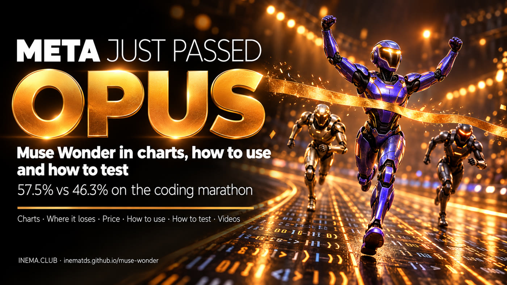

# 🏁 Muse Wonder — the Meta AI that passed Opus

**🇧🇷 [Português](README.md) · 🇺🇸 [English](README.en.md) · 🇪🇸 [Español](README.es.md)**

## What it is

On October 12, 2026, Meta released two AI models, Muse Wonder and Muse Wonder Full, built to work on their own for long stretches on coding and office tasks. This repository gathers the numbers checked against official and independent sources, shows where they beat and where they lose to Claude Opus 5.5 and GPT-6 Astra, and teaches you how to use them and test them yourself. It is for people who code with agents and want to decide with their own evidence. Nothing to install to read it.

## 📖 Guide

Comparison charts, where it loses, pricing, how to use and how to test: **https://inematds.github.io/muse-wonder/guia/en/**

## 🎬 Videos

- 16:9 explainer (3 min) and 9:16 reel (40 s), in Portuguese: in the [video-v1.0.0 release](https://github.com/inematds/muse-wonder/releases/tag/video-v1.0.0) and in the guide.

## By the numbers (sources in the guide)

| Test | Wonder Full | Wonder | Opus 5.5 | GPT-6 Astra |
|---|---|---|---|---|
| SWE-Marathon (Meta) | **57.5%** | 53.1% | 46.3% | 42.5% |
| ProgramBench (Meta) | 59.0% | 50.0% | **70.5%** | 52.5% |
| Artificial Analysis Index | 56 | 52 | **58** | 53 |
| Price per 1M tokens (input/output) | Muse Code only | US$ 4 / 20 | US$ 4 / 20 | US$ 10 / 50 |

Research from Oct 14, 2026 · [INEMA.CLUB](https://inema.club)
