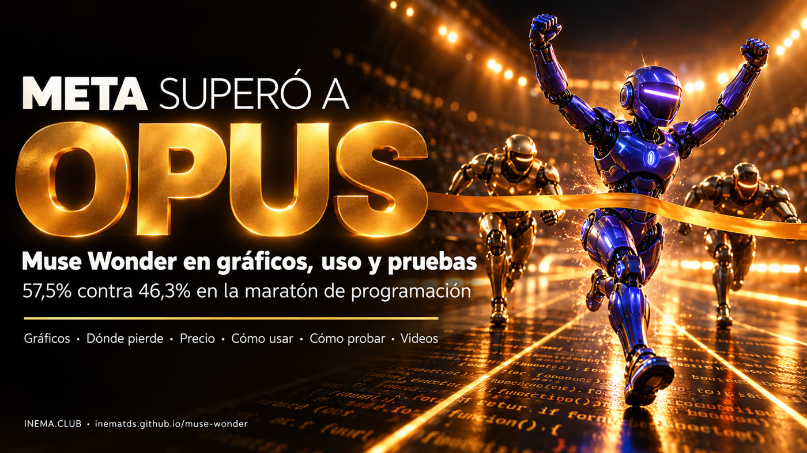

# 🏁 Muse Wonder — la IA de Meta que superó a Opus

**🇧🇷 [Português](README.md) · 🇺🇸 [English](README.en.md) · 🇪🇸 [Español](README.es.md)**

## Qué es

El 12 de octubre de 2026 Meta lanzó dos modelos de inteligencia artificial, Muse Wonder y Muse Wonder Full, hechos para trabajar solos durante mucho tiempo en programación y tareas de oficina. Este repositorio reúne los números verificados en fuentes oficiales e independientes, muestra dónde ganan y dónde pierden frente a Claude Opus 5.5 y GPT-6 Astra, y enseña a usarlos y a probarlos tú mismo. Sirve para quien programa con agentes y quiere decidir con pruebas propias. Para leerlo no hay que instalar nada.

## 📖 Guía

Gráficos comparativos, dónde pierde, precio, cómo usar y cómo probar: **https://inematds.github.io/muse-wonder/guia/es/**

## 🎬 Videos

- Explicativo 16:9 (2 min 15 s, [YouTube](https://www.youtube.com/watch?v=orU-IRYyh5k)) y reel 9:16 (40 s, [YouTube](https://www.youtube.com/shorts/FyEzfekpa10)), en portugués: en la [release video-v1.0.0](https://github.com/inematds/muse-wonder/releases/tag/video-v1.0.0) y en la guía.

## En números (fuentes en la guía)

| Prueba | Wonder Full | Wonder | Opus 5.5 | GPT-6 Astra |
|---|---|---|---|---|
| SWE-Marathon (Meta) | **57,5%** | 53,1% | 46,3% | 42,5% |
| ProgramBench (Meta) | 59,0% | 50,0% | **70,5%** | 52,5% |
| Índice Artificial Analysis | 56 | 52 | **58** | 53 |
| Precio por 1M tokens (entrada/salida) | solo Muse Code | US$ 4 / 20 | US$ 4 / 20 | US$ 10 / 50 |

Investigación del 14/10/2026 · [INEMA.CLUB](https://inema.club)
